<!-- AUTO-GENERATED by scripts/build.py from README.template.md + data/profile.json. Do not edit README.md by hand. -->

<h1 align="left">
  
</h1>

# About Me

I'm a **Computer Science** student at Universitas Bumigora Mataram **Indonesia**, passionate about building impactful digital solutions through software development. Aspiring to become a Full-Stack Developer, I'm continuously exploring front-end and back-end technologies, sharpening my **problem-solving skills**, and turning ideas into practical applications. I believe that every project is an opportunity to **learn, grow, and create something meaningful**.

# Socials

  
  
  
  

# Techstack & Tools

<h3 align="center">Stack</h3>

  

<h3 align="center">Tools</h3>

  

# Projects

### Featured

| Project | Description |
| :-- | :-- |
| [`program-kasir`](https://github.com/Zanuraen/program-kasir) | Cashier / point-of-sale app built with Dart for recording daily sales transactions. |
| [`Travel-App`](https://github.com/Zanuraen/Travel-App) | Mobile travel app UI built with Dart and Flutter. |
| [`firebase`](https://github.com/Zanuraen/firebase) | Firebase integration project covering authentication and cloud data for Flutter apps. |
| [`tugas-uts-pemograman-web-service`](https://github.com/Zanuraen/tugas-uts-pemograman-web-service) | Web service midterm project, built in collaboration with Dzaky. |

# Contributions

  
  

  

